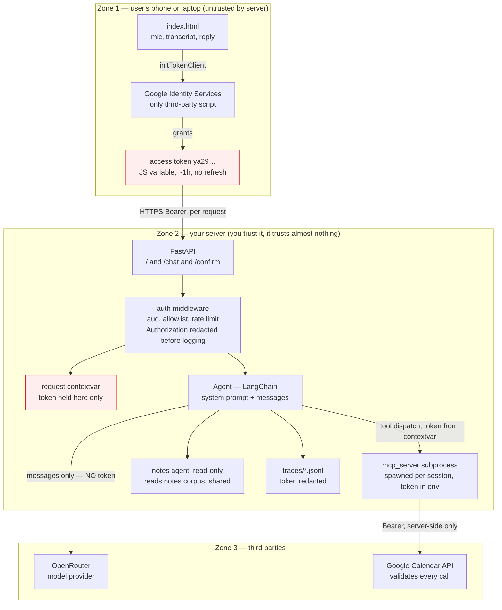
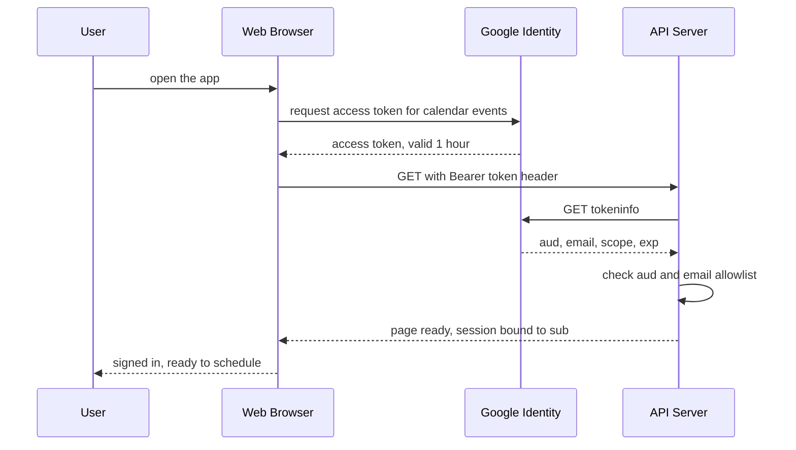
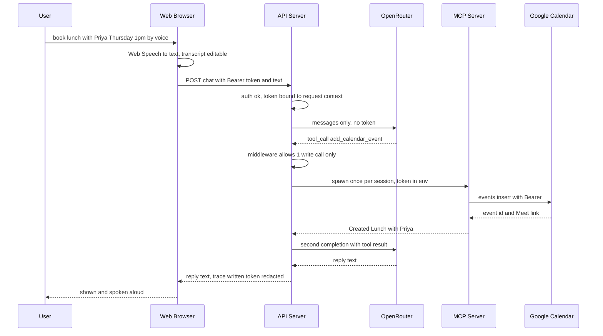
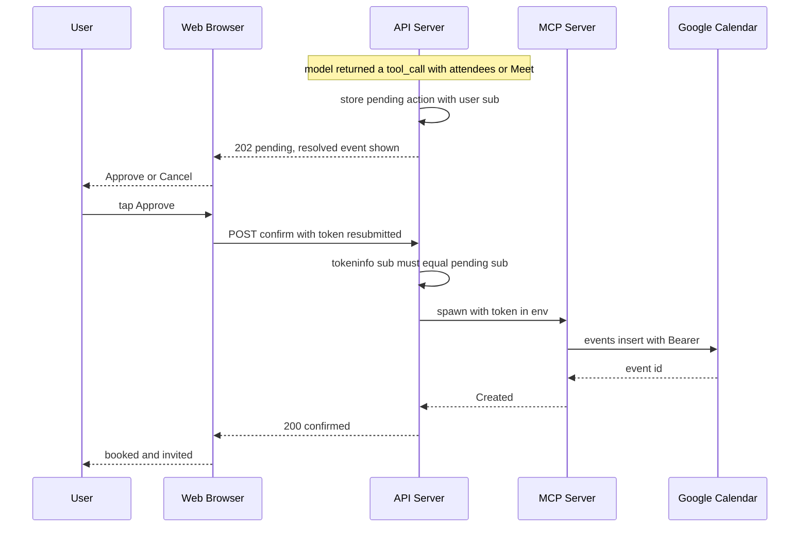
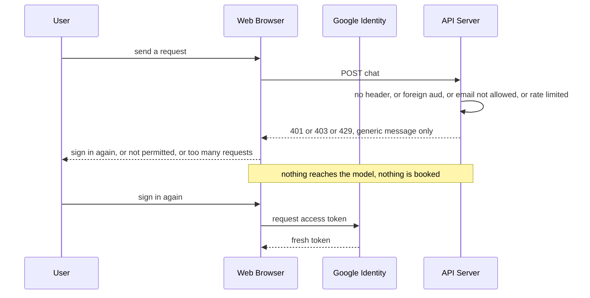
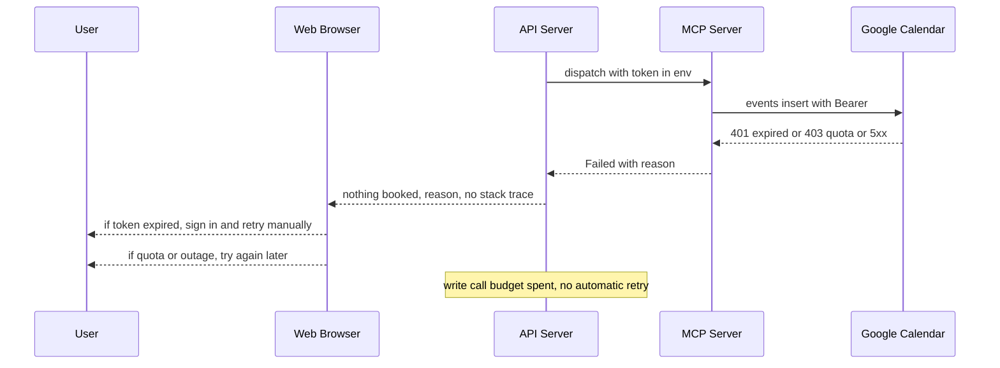
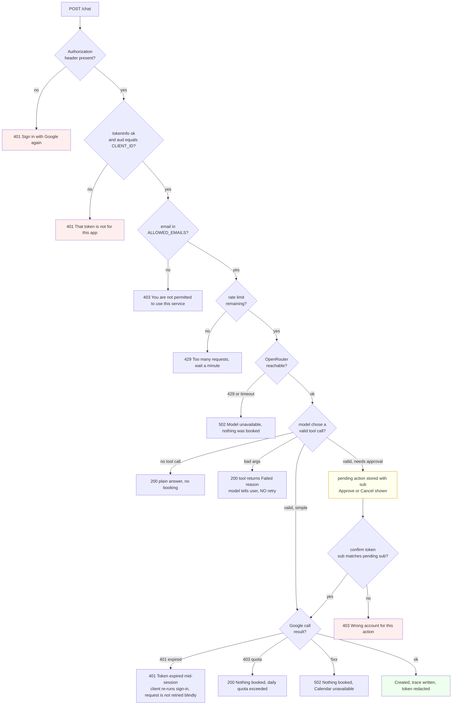

# Pitu - Calendar Agent — system and flow diagrams

Preview: `Cmd+Shift+V`. Diagrams use only baseline Mermaid syntax: no `actor` keyword, no `alt` blocks, no quotes, no slashes. If a sequence diagram still fails, your preview extension's Mermaid is old — update it, or paste the block into mermaid.live.

---

## 1. System design — three trust zones

The one-line rule this encodes: **the red boxes never touch the OpenRouter arrow.**

---

## 2. Use cases

### UC-1 · Sign in and bind a session

### UC-2 · Book a simple event (happy path)

### UC-3 · Book an event that needs approval (HITL)

### UC-4 · Rejected at the gate

### UC-5 · Booking fails at Google

---

## 3. Failure cases — full branch map

